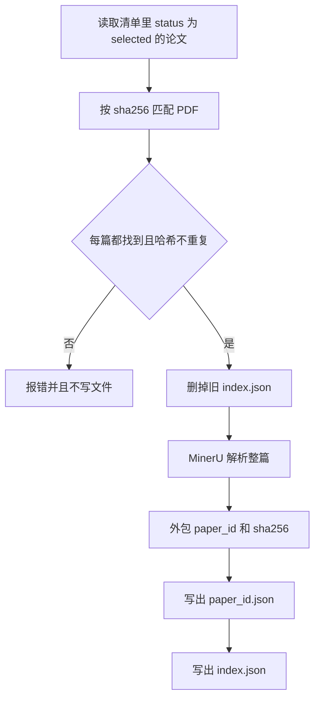
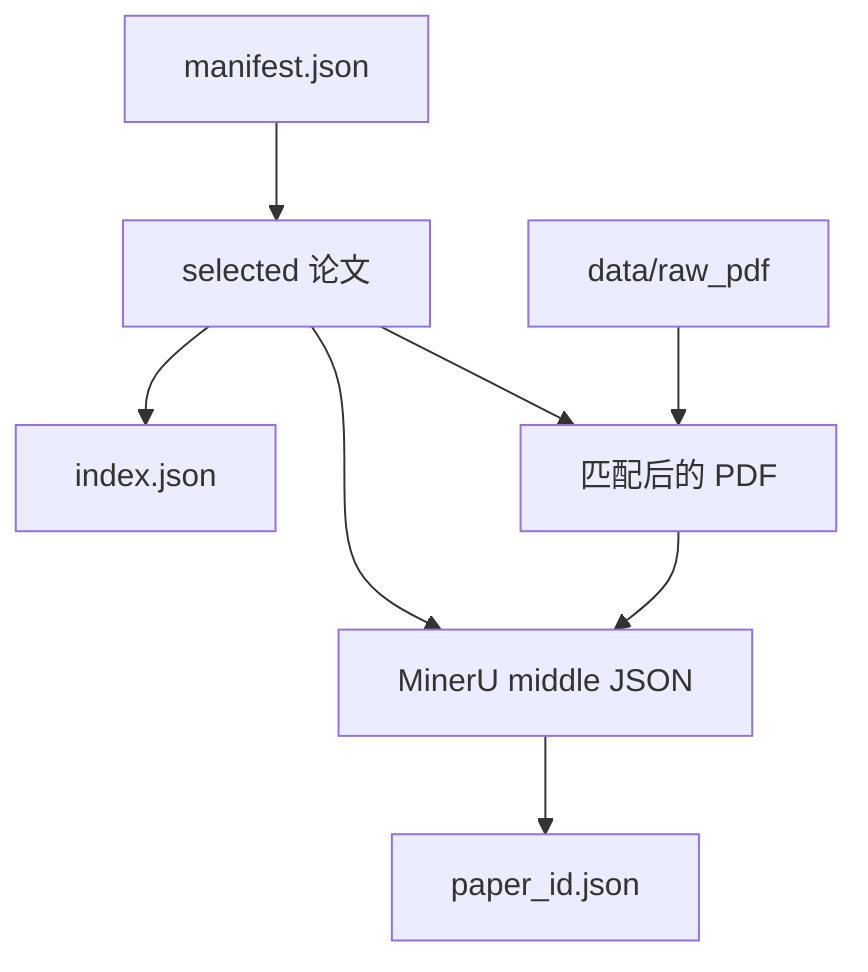

# 解析

导出用 MinerU。每篇论文写成一份 middle JSON，外层加上清单里的 `paper_id` 和 `sha256`。块的类型、层级、父子关系和行内样式按 MinerU 的结果保存。

2026-11-06 用现在这份 middle JSON 对照了同样的 4 页，顺序和内容与 PDF 一致。其余页没有看。结论在下面的「抽检」。

## 运行

在已激活的 `paper-trail` 环境里，于仓库根目录执行。第一次运行前先安装本包：

```powershell
pip install -e .
python -m paper_trail.parsing
```

这条命令导出清单里 `status` 为 `selected` 的论文，也就是 B0 那 6 篇的全部页。档位是 `standard`，模型用本机 MinerU 配置里的目录。结果在 `data/parsed/mineru/<paper_id>.json`，另有一份 `index.json`。`data/parsed/` 不提交。

程序用 `sha256` 到 `data/raw_pdf/` 匹配 PDF，不靠文件名。2026-11-05 这 6 篇的页数是：GPipe 10，Megatron-LM 15，ZeRO 24，PagedAttention 16，SmoothQuant 13，Medusa 27。

## 核心流程



## 数据流



## 一篇的 JSON

`huang-gpipe.json` 的外层是这份导出自己的字段，`middle` 是 MinerU 的 middle JSON，块没有重排，也没有收成统一的 `text` / `image`。下面只写出外层和第 2 页的一个块，块取自 2026-11-05 的导出，其余字段省略：

```json
{
  "dump_version": 2,
  "parser": "mineru",
  "paper_id": "huang-gpipe",
  "sha256": "清单中该文件的 sha256",
  "source_name": "NeurIPS-2019-gpipe-....pdf",
  "middle": {
    "schema": "docvortex.middle",
    "pages": [
      {
        "page_idx": 1,
        "blocks": [
          {
            "type": "paragraph_title",
            "index": 5,
            "bbox": [0.173, 0.725, 0.368, 0.744],
            "content": [{"type": "text", "content": "2 The GPipe Library"}],
            "level": 2
          }
        ]
      }
    ]
  }
}
```

`page_idx` 从 0 开始，是原 PDF 的页号。`index.json` 里的 `pages` 写成从 1 开始，所以上面这一页在索引里是 `2`。`bbox` 是相对页宽、页高的 0–1 坐标，原点在左上，y 向下。每页的宽和高（单位是点）在 `middle.extensions.docvortex_layout.pages`，B0 这 6 篇都是 612×792。MinerU 的版本和档位在 `middle.metadata.producer` 与 `middle.extensions.mineru`。

块类型留着 MinerU 的名字，例如 `paragraph_title`、`header`、`footer`、`page_footnote`、`equation`、`image`、`chart`、`table`。标题带 `level`。MinerU 认出图注时，`image_caption`、`table_caption` 放在父块的 `content` 里。它没认出时，图注是单独的 `text` 块：GPipe 第 2 页 Figure 1 的图注就是 `index` 为 0 的 `text`，两张图是后面的两个 `chart`。行内公式是 `equation_inline`，脚注标记也可能写成这种公式，例如 `^{1}`。

文件按 MinerU 的写法省略默认值。空的 `styles`、为空的 `continues_prev` 不写。读的时候缺字段按默认值处理，也可以用 `mineru.parser.base.ParseResult.from_dict(document["middle"])` 读回成带类型的对象。6 篇都能这样读回。

PDF 的 `image_base64` 不写入。这也是 MinerU 自己写 middle JSON 时的约定。图片块仍保留类型、框和文字。

`index.json` 记录这次导出了哪些论文和页码。导出开始时先删掉旧的 `index.json`，最后一篇写完才写新的。没有 `index.json` 说明上次导出没有跑完，目录里可能是新旧混合的文件。后面读结果时从 `index.json` 列出的论文开始，不要按目录里有什么文件来读。

## 抽检

2026-11-05，PyMuPDF 和 MinerU 各对照了 B0 那 6 篇论文里抽检的 4 页。当时看的是扁平化之后的 txt：MinerU 的类型被收成 `text` 或 `image`，阅读顺序按坐标重算。其余页没有看。下面两张表只描述那次对照，不描述现在这份 middle JSON。

PyMuPDF：

| 页 | 结果 |
|---|---|
| Megatron-LM 第 2 页 | 正文先左栏后右栏，与 PDF 一致。页眉标为 `header`。Figure 1 只有图注，没有图块。 |
| Megatron-LM 第 6 页 | 正文顺序一致。Table 1 标了 `overlaps_table`，格子按从左到右排，行和列对不齐。文件末尾的 `tables` 只记了框和 `2x6`。Figure 5 里的文字和数字被抽成正文，没有 `image`。 |
| GPipe 第 2 页 | 切分和顺序与 PDF 一致。图表上的文字没有被抽出来。 |
| Medusa 第 2 页 | `[6]` 到 `[22]` 是图里的文字，被抽成正文，没有 `image`。脚注角标 `1` 变成普通数字，粘在 `dataset1` 和 `1Upon` 上。脚注正文仍在，阅读顺序没有因此打乱。 |

MinerU 的扁平化结果：

| 页 | 结果 |
|---|---|
| Megatron-LM 第 2 页 | 顺序与 PDF 一致。Figure 1 是 `image`，图注是一整句。 |
| Megatron-LM 第 6 页 | 顺序与 PDF 一致。Figure 5 是 `image`，图注是一整句。Table 1 保留 HTML，行列还在，`tables` 记为 `5x6`。 |
| GPipe 第 2 页 | 顺序与 PDF 一致。图被标成 `image`。正文下标写成 `L_{i}`、`p_{k}` 这种形式。 |
| Medusa 第 2 页 | 顺序与 PDF 一致。图是 `image`。脚注角标 `1` 仍粘在 `dataset1` 上，脚注正文仍是 `1Upon`。 |

这 4 页的扁平化结果里，图块、表格 HTML 和下标是 MinerU 留下的，所以选定 MinerU。PyMuPDF 导出和按坐标重排的代码已从当前源码移除。扁平化会丢掉上标样式，所以当时写成了 `dataset1`。

2026-11-06 用现在这份 middle JSON 又对照了这 4 页。顺序与 PDF 一致，文字完整。标题是 `paragraph_title`，图注在 `chart` 或 `image` 里面，表注在 `table` 里面，表格正文是 HTML。下标和行内公式是 `equation_inline`，例如 GPipe 的 `L_{i}`、`T(L,H,A)`。Medusa 第 2 页的脚注标记是单独的 `^{1}`，脚注块 `page_footnote` 也以 `^{1}` 开头，不再是 `dataset1` 和 `1Upon`。

这两处和 PDF 不完全一样，但不影响把这 4 页读完：

- Megatron-LM 第 2 页作者肩标里的 `1` 带 `superscript`，旁边的 `2` 没有。
- 标准档把文档标题以外的标题都写成 `level` 为 2。`2.1` 和 `2` 是同一级。不带下标的单个斜体字母，例如 GPipe 里的 `L`、`K`，写成普通大写字母。

选型抽检仍是这 4 页。Megatron-LM 第 12 页后来对照过，Figure 8 被收进表格 HTML，见 [CHUNKING.md](CHUNKING.md)。其余页没有对照。

分块已经读这些块，规则见 [CHUNKING.md](CHUNKING.md)。
