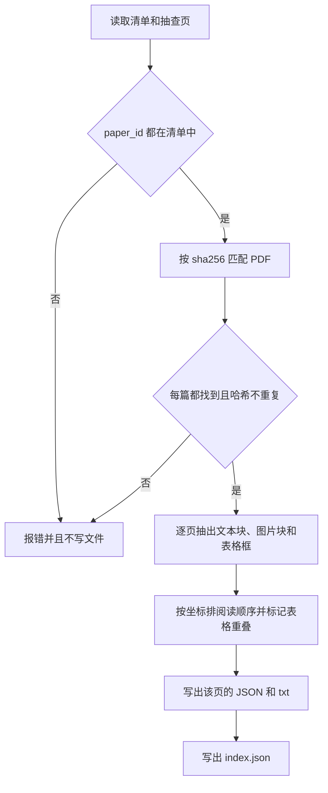
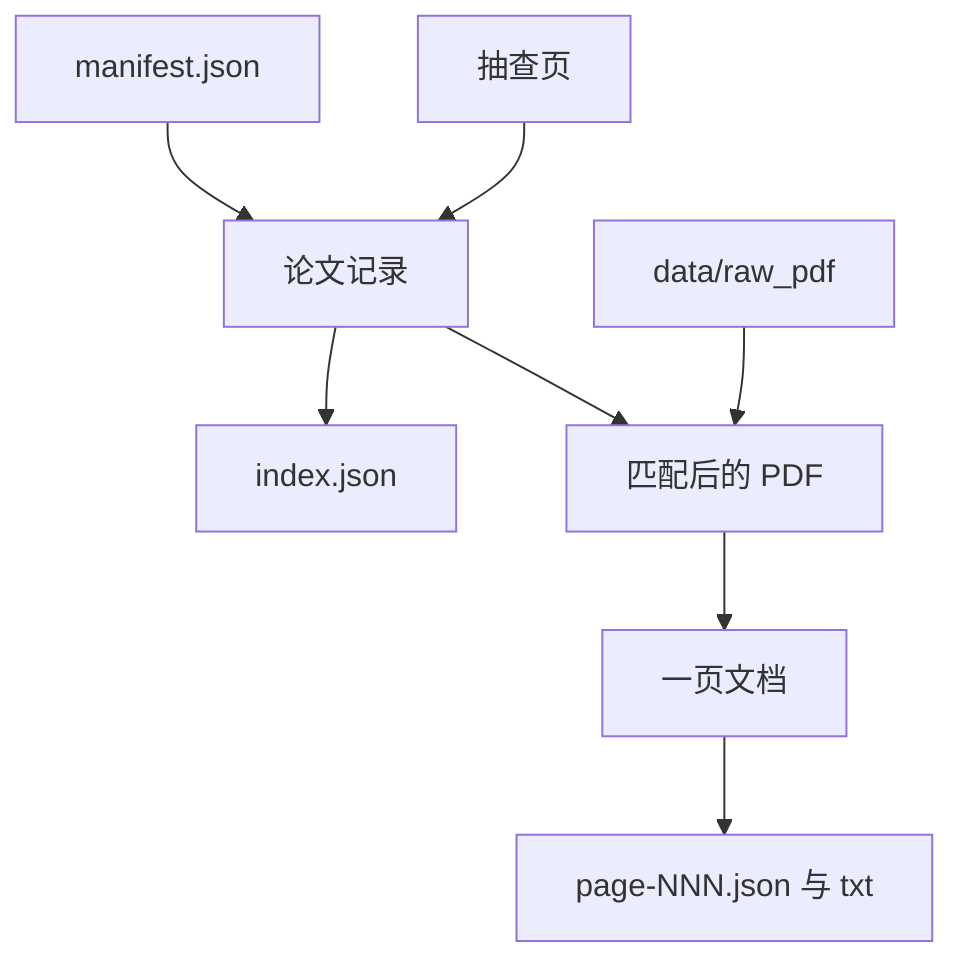

# 解析

当前只导出抽查页，用来检查阅读顺序。还没有解析全文，也没有接入 MinerU。

## 运行

在已激活的 `paper-trail` 环境里，于仓库根目录执行。第一次运行前先安装本包和 PyMuPDF：

```powershell
pip install -e .
python -m paper_trail.parsing
```

程序读取 `data/manifest.json`，用 `sha256` 到 `data/raw_pdf/` 匹配 PDF，再导出下面这些页。页码从 1 开始。

| paper_id | 页 |
|---|---|
| shoeybi-megatron-lm | 2、6 |
| kwon-pagedattention | 2、5 |
| huang-gpipe | 2、3、4 |
| rajbhandari-zero | 2 |
| cai-medusa | 2、7 |
| xiao-smoothquant | 2 |

## 核心流程



## 数据流

清单和抽查页先合成论文记录。论文记录配上 PDF 得到每一页的文档，再写成页文件。`index.json` 只来自论文记录，不经过页内的块。



## 输出位置

PyMuPDF 写到 `data/parsed/pymupdf/<paper_id>/`。每个页有 `page-002.json` 和同名 `.txt`。目录名里的页码是三位。`index.json` 记录这次导出了哪些论文和页。

以后 MinerU 写到 `data/parsed/mineru/<paper_id>/`。两份结果的 JSON 字段相同，用 `parser` 区分，取值是 `pymupdf` 或 `mineru`。`data/parsed/` 不提交。

## 一页的 JSON

`page-002.json` 是这一页的完整结果。`page-002.txt` 是同一份内容的可读文本，不另定字段。下面是缩短后的一页，坐标和文字只作格式示例：

```json
{
  "dump_version": 1,
  "parser": "pymupdf",
  "paper_id": "shoeybi-megatron-lm",
  "sha256": "清单中该文件的 sha256",
  "source_name": "1909.08053v4.pdf",
  "page": 2,
  "page_width": 612.0,
  "page_height": 792.0,
  "blocks": [
    {
      "reading_order": 0,
      "column": "left",
      "region": "body",
      "bbox": [55.0, 100.0, 290.0, 130.0],
      "text": "这一块的文字",
      "kind": "text",
      "overlaps_table": false
    }
  ],
  "tables": [
    { "bbox": [311.6, 100.2, 560.0, 180.0], "rows": 2, "cols": 6 }
  ],
  "table_error": null
}
```

`blocks` 已按阅读顺序排列，`reading_order` 从 0 递增。`column` 取 `left`、`right` 或 `full`。`region` 取 `body`、`header` 或 `footer`。`bbox` 是 `[x0, y0, x1, y1]`，单位是点，保留一位小数。`kind` 取 `text` 或 `image`；图片块的 `text` 为空。`overlaps_table` 为 true 表示该块至少有 30% 的面积落在某个表格框内，原文仍保留。

`tables` 是本页找到的表格框。没找到时为空数组。找表格失败时，`table_error` 是错误文字，`blocks` 仍然导出。

`index.json` 只记录这次导出了哪些页：

```json
{
  "dump_version": 1,
  "parser": "pymupdf",
  "papers": [
    {
      "paper_id": "shoeybi-megatron-lm",
      "sha256": "清单中该文件的 sha256",
      "source_name": "1909.08053v4.pdf",
      "pages": [2, 6]
    }
  ]
}
```

## 阅读顺序

每个文本块或图片块有矩形坐标。按页宽把它分成三栏：

- 块同时跨过页面左侧 35% 和右侧 65%，或者宽度达到页宽的 60%，算通栏。
- 其余块的左边缘不小于页宽的 42%，算右栏。
- 剩下的算左栏。

通栏块按自上而下的位置把页面切开。每一段里先排左栏，再排右栏，然后才是这段下方的通栏块。上边缘 `y0` 和某个通栏块相同的栏内块，排在该通栏块之后。

页眉、页脚只做标记，不从结果里删除。判定边距是 54 点。贯穿整页的块仍标为正文。

PyMuPDF 给出的表格框写在 `tables` 里。面积有至少 30% 落在某个表格框内的文本块保留原文，并设 `overlaps_table` 为 true。表格找失败时，`table_error` 记下原因，这一页的文本块仍然导出。

## 还没做

- 把表格文字从正文里拿掉，只留一份表格内容。
- 图注和图片绑定，公式、参考文献与正文分开。
- 用 MinerU 对同样的页再导出一份。
